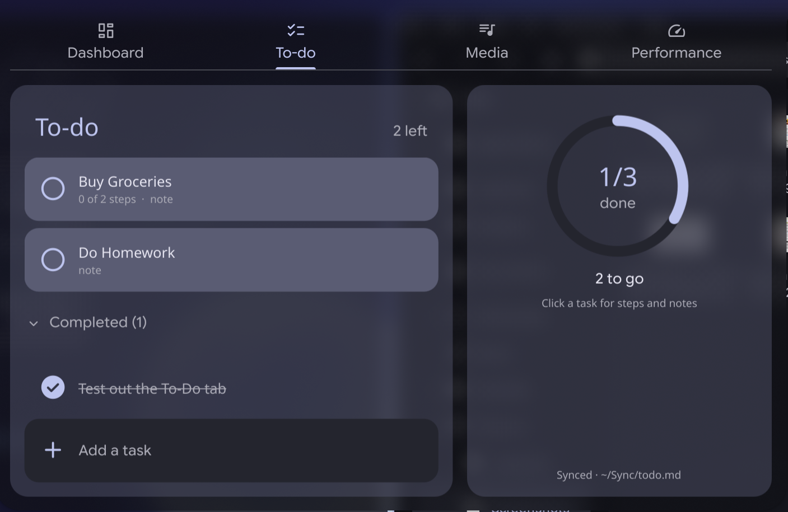
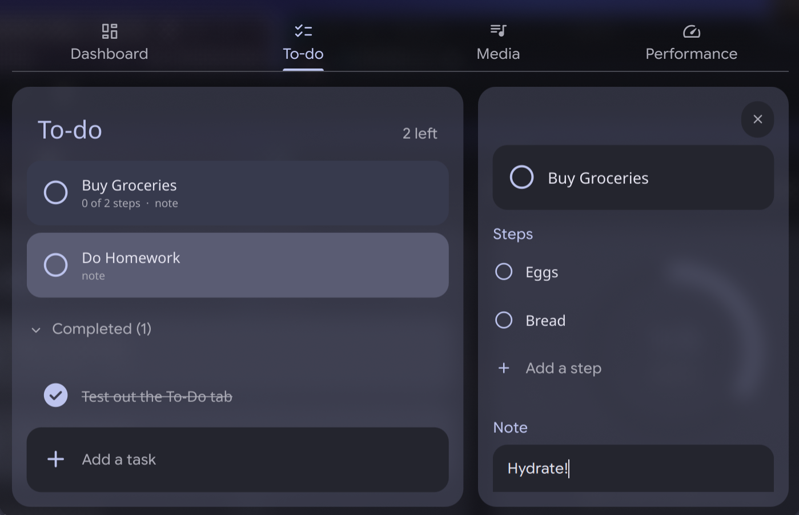

# My Caelestia rice

My personal fork of [Caelestia Shell](https://github.com/caelestia-dots/shell),
a Quickshell-based desktop shell for Hyprland. All credit for the shell goes to
the Caelestia developers. This branch (`my-rice`) adds my own changes on top.

Upstream documentation: see [`README.md`](../README.md).

## Changes

### Dashboard user card
- Hid the OS logo and uptime badges
- The thought bubble shows a mood read from `~/.config/caelestia/mood.txt`

Set a mood:

    echo "locking in ⭐" > ~/.config/caelestia/mood.txt

### To-do tab

A Microsoft To Do–style tab next to Dashboard (`modules/dashboard/Todo.qml`):
- Tasks, steps and notes, stored in `~/Sync/todo.md`
- Check off, add and delete tasks and steps; notes autosave
- Progress ring; follows the wallpaper colour scheme
- Synced to my phone with Syncthing (edited there in Obsidian)

File format:

    - [ ] a task
        - [x] a finished step
        - [ ] an open step
        > a note line
    - [x] a finished task

### Other
- `modules/drawers/ContentWindow.qml`: the dashboard accepts keyboard input on click (needed for typing in the To-do tab)

## Updating

I use `caelestia-shell-git`. After a system update:

    pacman -Qs caelestia          # note the hash after "g"
    git fetch upstream
    git merge <hash>